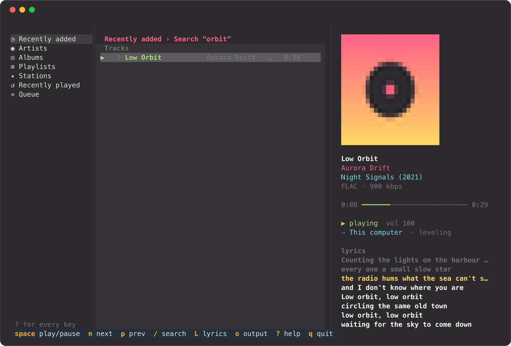

# tamp

A keyboard-driven Plex music player for the terminal. Browse and search your library, see synced lyrics, edit the queue and playlists. Play right in the terminal, or use tamp as a remote and lyrics screen for Plexamp running somewhere else.

> [!WARNING]
> **This is vibe-coded.** It was written largely by an AI assistant (Claude) as a proof of concept, with a human steering, testing and reviewing it. It works for its author, but it hasn't had the scrutiny a hand-written project gets. Expect rough edges, read the code before trusting it with anything important, and file issues freely. tamp is not affiliated with or endorsed by Plex.



## What it does

- **Sign in with a link.** Press `c` to copy it or `o` to open it, scan the QR code with your phone, or type the four-letter code at plex.tv/link. Then pick a Plex Home user (with their PIN if they have one), a server and a music library.
- **Browse** recently added albums, artists, albums, playlists, stations and recently played tracks. **Search** everything with `/`.
- **Play here**, gapless, through [mpv](https://mpv.io). Loudness leveling uses Plex's own sonic analysis (`v` toggles it).
- **Remote control and follow mode.** `o` picks where the music plays: this terminal, or a Plexamp / Plex player elsewhere. tamp always shows what that player is playing, with the album art and synced lyrics. It reads this from your Plex server's session list, so it works for a phone too. Players that accept remote control (Plexamp desktop or headless with remote control turned on) can also be paused, skipped and handed a new queue.
- **Synced lyrics** beside the music, or full screen with `L`. They need Plex Pass, or lyrics on your server.
- **Radio**: `r` on a track plays sonically similar tracks; on an artist it plays artist radio; your server's stations are listed too.
- **Queue**: add (`a`), play next (`N`), shuffle, repeat, reorder (`J`/`K`), remove (`d`), save as a playlist (`w`). It's kept between runs.
- **Playlists**: add the selection to a playlist or a new one (`P`). Like tracks (`f`, or `*` for what's playing).
- **Reports plays to Plex**, so your history, play counts and "recently played" stay right.
- **Sleep timer** (`z`), **tmux status** (`tamp status`) and **command-line control** (`tamp toggle`, `next`, `prev`) for key bindings.

`?` lists every key. `tamp --demo` runs an invented offline library, so you can try it without a server.

## Install

Needs Python 3.11+, [uv](https://docs.astral.sh/uv/) and mpv (`brew install mpv`, `apt install mpv`, `dnf install mpv`, `pacman -S mpv`).

```sh
uv tool install git+https://github.com/samayc16/tamp
tamp            # sign in, then play
tamp --demo     # no Plex needed
```

## Use it from tmux

```tmux
set -g status-right '#(tamp status --tmux --width 40)%H:%M'
bind-key M-p run-shell 'tamp toggle'
bind-key M-n run-shell 'tamp next'
```

## How it works

| module | job |
|---|---|
| `plex.py` | plex.tv sign-in (two PINs: browser link and plex.tv/link code), Home users, servers, players |
| `library.py` | browsing, search, radio, lyrics, art, ratings and play reports on a Plex Media Server (via [python-plexapi](https://github.com/pushingkarmaorg/python-plexapi)); `demo.py` is an offline stand-in |
| `mpv.py`, `output.py` | local playback through one mpv over JSON IPC (its playlist holds the current track and the next one, for gapless); remote players through Plex's companion API, with state from the server's sessions |
| `player.py`, `queue.py` | the queue as an immutable value, transport, play reporting, the status file for tmux |
| `ui/` | the [Textual](https://textual.textualize.io) app |

Your Plex token is stored in `~/.config/tamp/config.json`, readable only by you. It's sent to your server as a header, never in a URL or on a command line.

This Python version is the proof of concept. The plan is a Rust rewrite (ratatui + mpv) once the features have settled.

## Development

```sh
uv venv && uv pip install -e '.[test]'
.venv/bin/pytest
```

MIT licensed.
