# plexamp-tui

**A Plexamp-style music player and remote for the terminal.** Browse your Plex library, follow synced lyrics, edit the queue, and play right in the terminal, or drive Plexamp on your phone, desktop or headless box from it. The command is `tamp`.

> [!NOTE]
> **Work in progress: a proof of concept.** It's what I use every day, but it's young. Expect rough edges, and please open an issue when something breaks.

> [!WARNING]
> **AI-assisted.** Most of the code was written by an AI assistant (Claude), with me steering, testing on my own setup and reviewing every change. It has an automated test suite and has been through security-minded reviews (see [How it works](#how-it-works)), but it hasn't had the scrutiny a hand-written project gets. The code is small and readable; please read it before trusting it. tamp is not affiliated with or endorsed by Plex.

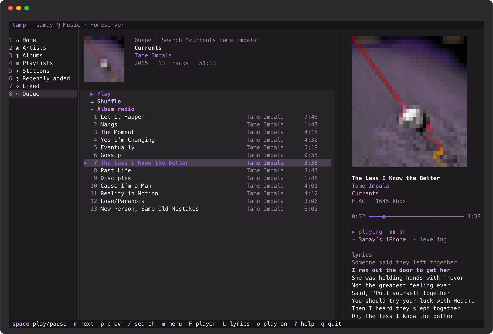

## Why

I spend my working day in a terminal and like to stay in flow there. I usually listen with AirPods connected to my iPhone, with Plexamp doing the playing. tamp lets me run that phone from the terminal I'm already in. I get a good-looking controller with synced lyrics, the real queue and all the usual comforts of a music player, without picking up the phone. When I'm at my desk without the phone, it plays right in the terminal instead.

## Features

**Remote control** (`o`, "Play on")
- Control Plexamp on your phone, desktop or headless box: play, pause, skip, seek, volume, and queue anything.
- It shows that device's *real* queue, the one you started on the phone, and keeps the lyrics in time. You can add to that queue and jump around in it.
- When a player can't be reached (your phone left the Wi-Fi), tamp still follows along: now playing, art and lyrics.

**Plays here too**
- Gapless playback through [mpv](https://mpv.io), with loudness leveling from Plex's own sonic analysis (mpv 0.38 or newer).
- Plays are reported to Plex, so history, play counts and "recently played" stay right everywhere.

**Lyrics**
- Synced lyrics beside the music, full size (`L`), or in a full-screen player with big art (`F`).
- The line being sung is highlighted. Click any line to jump there.

**Library**
- Home from your server's hubs: your mixes, recently played, recently added, stations and playlists.
- Artists (popular tracks, albums, singles, similar artists), albums, playlists, stations and liked tracks.
- Search as you type (`/`).
- Radio from anything (`r`).

**Queue, like Plexamp's**
- *Play next*, *Add to Up Next* and *Play last*; the queue shows Played, Now playing, Up next and the rest.
- Reorder by dragging, or with `J`/`K` (shift+↑↓). `N` and `a` move a track to the front or end of Up Next.
- Shuffle, repeat, remove, and save the queue as a playlist. It survives restarts.

**Themes** (`T`)
- *auto*: colours taken from the playing album's art, and your terminal's own colours when nothing plays.
- Built in: Monokai Pro, Catppuccin (Mocha, Latte), Dracula, Solarized (dark, light), Gruvbox, Nord, Tokyo Night, Rosé Pine, and *terminal*. It previews live as you move through the list.
- [Make your own](#themes) in a few lines of TOML.

**Comfortable**
- Right-click (or `m`) any row for everything you can do with it.
- Mouse throughout: click, double-click to play, drag the progress bar to seek, drag rows in the queue.
- Vim keys, a searchable help screen (`?`), track info (`i`), a sleep timer (`z`) and liking (`f`).
- Sign in with a link (`o` opens it, `c` copies it), a QR code, or a code at plex.tv/link. Plex Home users with PINs work.
- `tamp status` for your tmux bar.

## Screenshots

Everything here is my real library, playing on my iPhone or through mpv on my Mac. With the *auto* theme, every screen takes its colours from the album that's playing.

<table>
  <tr>
    <td width="50%">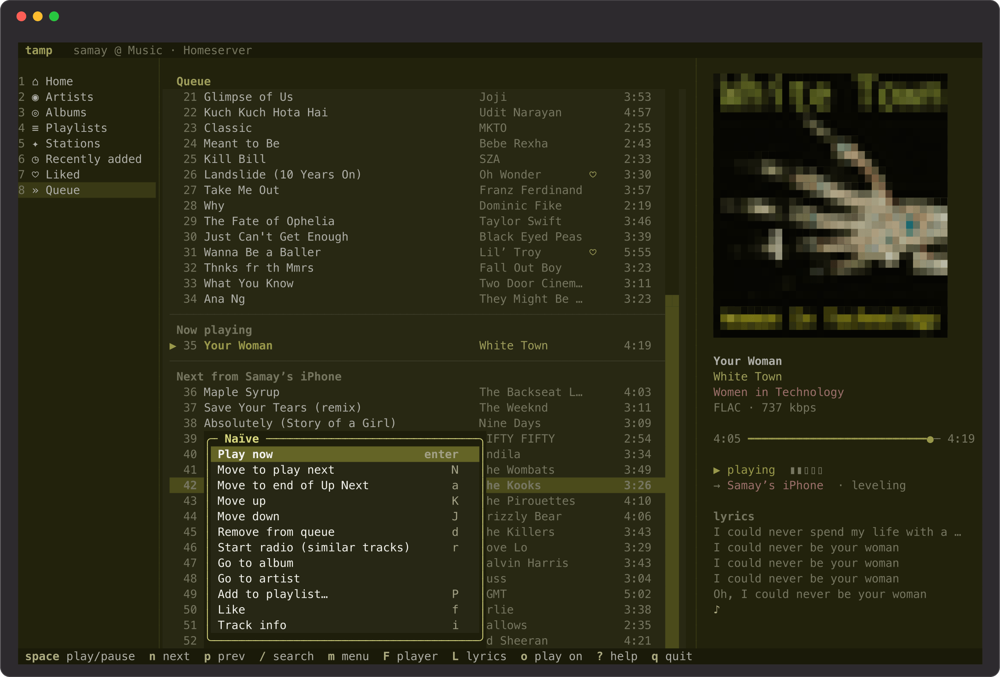<br>My phone's real queue, and the menu for a row (right-click or <code>m</code>). On a phone, tamp adds to the queue and jumps within it; moving and removing tracks there isn't supported yet. Colours from White Town's cover.</td>
    <td width="50%">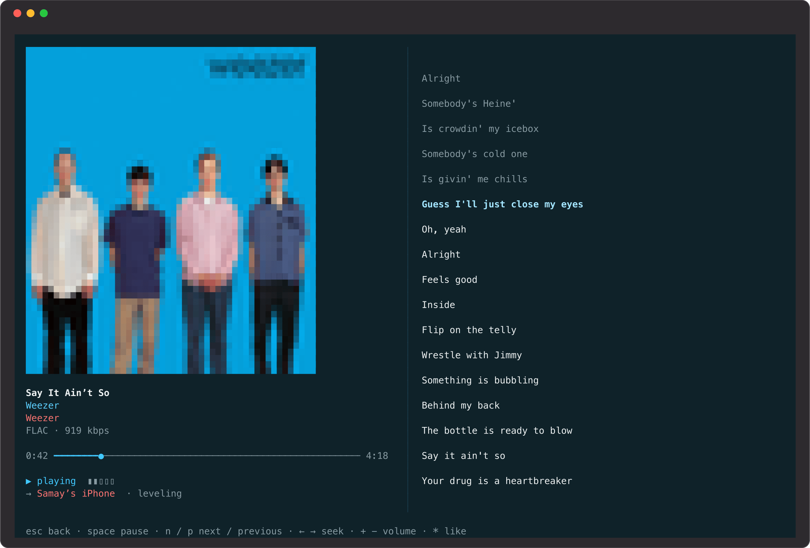<br><code>F</code>: the full-screen player, following my iPhone</td>
  </tr>
  <tr>
    <td>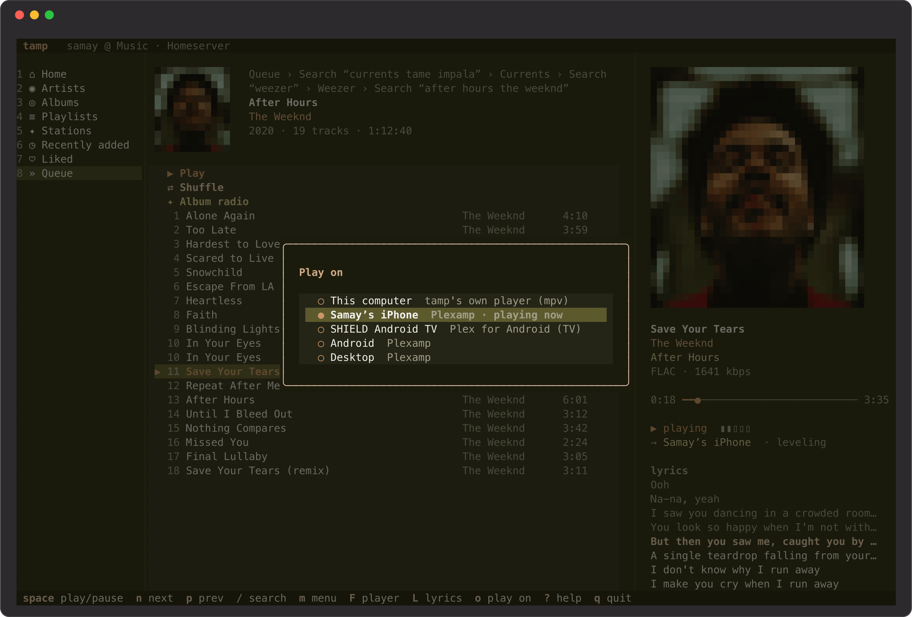<br><code>o</code>: play here or on any of your players</td>
    <td>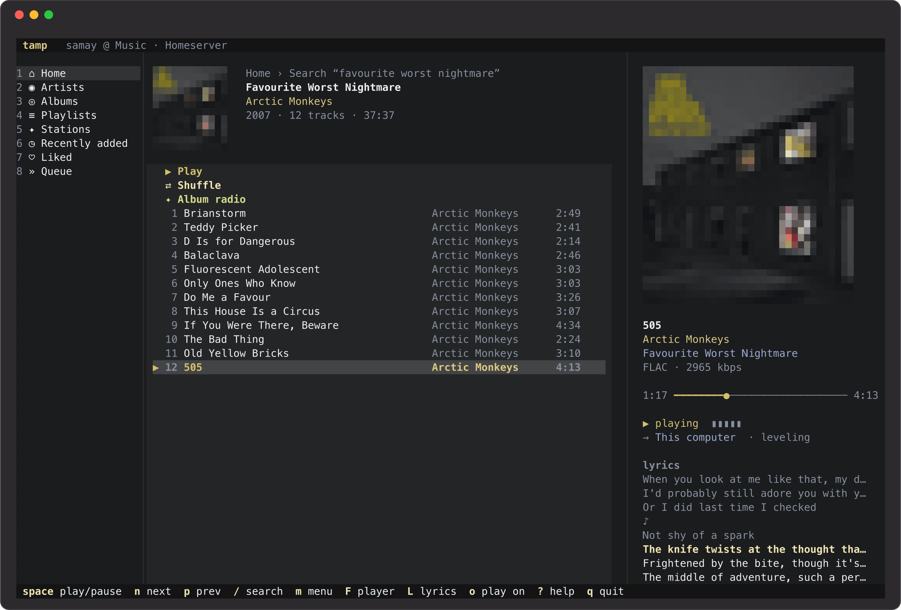<br>Playing here, through mpv</td>
  </tr>
  <tr>
    <td>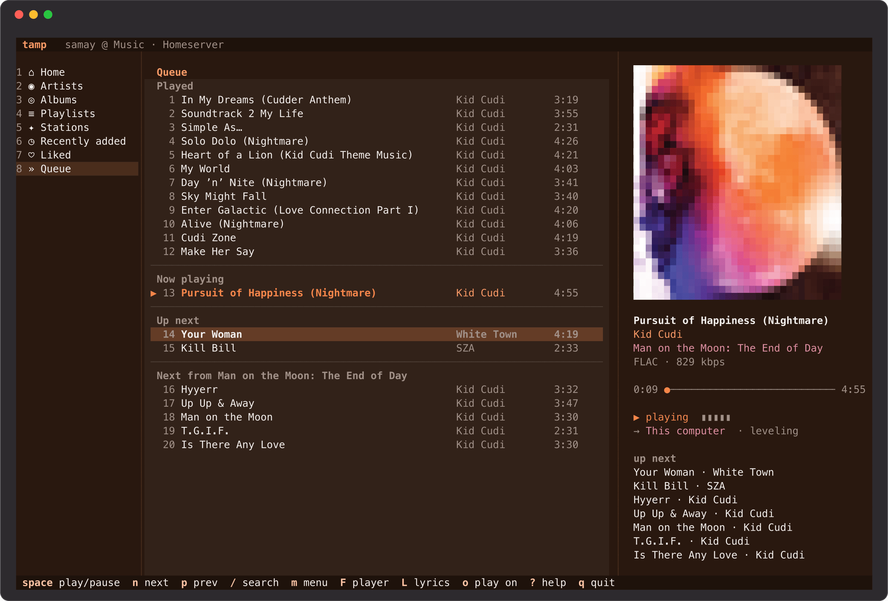<br>Up Next, like Plexamp's</td>
    <td>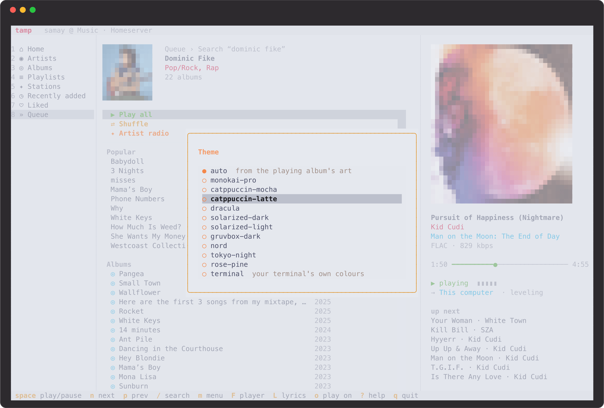<br><code>T</code>: themes, previewed live as you move</td>
  </tr>
  <tr>
    <td>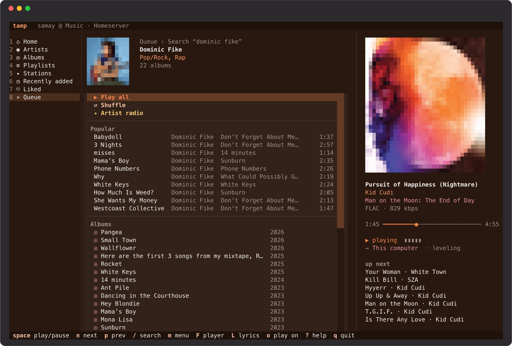<br>Artist pages</td>
    <td>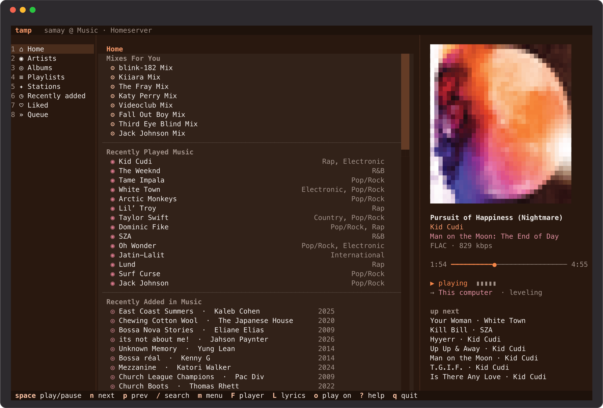<br>Home, from your server's hubs</td>
  </tr>
  <tr>
    <td>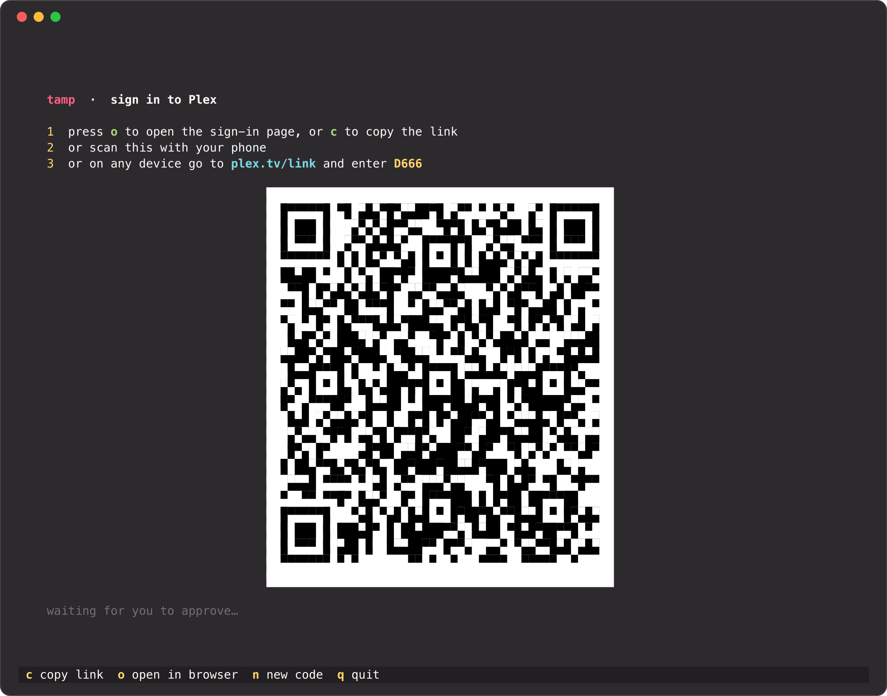<br>Sign in with a link, a QR code or a code</td>
    <td>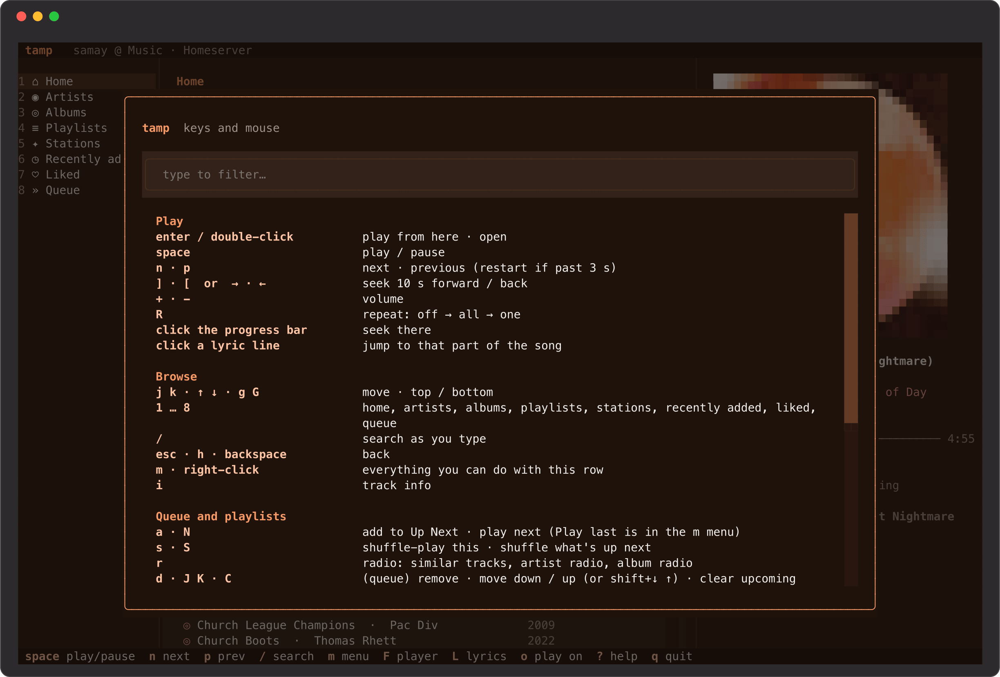<br><code>?</code>: every key and mouse action, searchable</td>
  </tr>
</table>

## Install

tamp runs on macOS and Linux. You need a Plex Media Server with a music library, Python 3.11+, [uv](https://docs.astral.sh/uv/) and mpv 0.35 or newer. Loudness leveling needs mpv 0.38; with an older one (Ubuntu 24.04 ships 0.37, Debian 12 ships 0.35) tamp plays without it and says so.
- macOS: `brew install mpv`
- Debian / Ubuntu: `sudo apt install mpv`
- Fedora: `sudo dnf install mpv`
- Arch: `sudo pacman -S mpv`

```sh
uv tool install git+https://github.com/samayc16/plexamp-tui
tamp
```

Update with `uv tool upgrade plexamp-tui`. Every version is on the [Releases](https://github.com/samayc16/plexamp-tui/releases) page: `uv tool install git+https://github.com/samayc16/plexamp-tui@v0.1.0` installs a specific one, and the `edge` release is the latest commit that passed every test.

Lyrics, sonic radio and similar artists come from your server's Plex Pass features (as they do in Plexamp). Without them, tamp still browses, plays and remote-controls; those parts just stay empty.

**Signing in:** press `o` to open the Plex sign-in page or `c` to copy the link, scan the QR code with your phone, or enter the four-letter code at plex.tv/link. Then pick a Plex Home user (with their PIN if they have one), a server and a music library. `tamp logout` forgets it all.

## Remote control

Press `o` to choose where music plays. tamp finds players three ways: Plexamp on this computer, players registered on your Plex account, and players answering Plex's discovery broadcast on your network. It talks to them with the same remote-control protocol (Plex Companion) that Plexamp uses between its own devices.

| player | control from tamp | needs |
|---|---|---|
| **Plexamp on an iPhone** | full while Plexamp is alive (it is while it's playing) | same Wi-Fi, and Plexamp allowed *Local Network* access in iOS Settings |
| **Plexamp on Android** | full while the app is running | same network |
| **Plexamp on a Mac / PC** | full | same network, and *Remote Control* turned on in Plexamp's settings |
| **Plexamp headless / Caldera** | full | same network |
| **any of these, away from home** | follow: now playing, art and synced lyrics | nothing |

**Follow mode:** when a player can't be reached, tamp still shows what it's playing. Every Plex player reports its playback to your server, so tamp reads that and keeps the lyrics in time. This covers your phone on cellular, or Plexamp asleep in the background.

**Away from home:** Plexamp's own remote control works through a private Plex cloud relay that other apps can't use, so tamp only follows there.

**The player's queue:** tamp shows it as it is, adds to it (*Play next*, *Add to Up Next*) and jumps to any track in it without replacing it. Moving, removing or shuffling its tracks, clearing it and *Play last* aren't available on a remote player yet; tamp says so instead of changing only its own copy.

## Themes

Press `T` to pick one; it's remembered. To make your own, add `~/.config/tamp/themes/<name>.toml`. Start from a built-in, then change any of its colours:

```toml
extends = "nord"
accent = "#ff79c6"     # artists, titles, borders
highlight = "#f1fa8c"  # the sung lyric line, key hints
```

The colours you can set: `bg`, `panel`, `overlay`, `line`, `select`, `hover`, `fg`, `dim`, `accent`, `playing`, `highlight`, `album`, `extra` and `warm`. Each takes `#rrggbb` or a terminal colour name like `bright_blue`.

## Configuration

`~/.config/tamp/config.json` holds your sign-in and choices, and only you can read it. Besides the theme, two settings are worth knowing:
- `"mpv_args": ["--audio-device=coreaudio/AppleUSBAudioEngine:…"]`: extra mpv options for local playback, such as which audio device to use (`mpv --audio-device=help` lists them).
- `"loudness_leveling": false`: turn leveling off (or press `v`).

## Use it from tmux

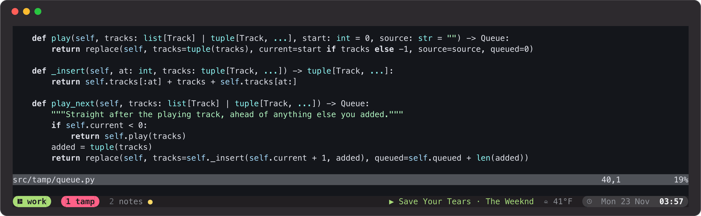

What's playing, wherever it plays, in your status bar, plus Option/Alt keys that work from any pane:

```tmux
set -g status-right '#(tamp status --tmux --width 40)  %H:%M'

# Alt+p play/pause, Alt+n next (no prefix); quietly nothing when tamp isn't running
bind -n M-p run-shell -b 'tamp toggle >/dev/null 2>&1; true'
bind -n M-n run-shell -b 'tamp next >/dev/null 2>&1; true'
```

On macOS, Option has to act as Alt in your terminal: `macos_option_as_alt yes` in kitty, *Use Option as Meta key* in iTerm2 or Terminal, `macos-option-as-alt = true` in Ghostty. Reload with `tmux source-file ~/.tmux.conf`.

`tamp toggle`, `next`, `prev` and `stop` control the running tamp from anywhere, including when it's driving your phone.

## Roadmap

Ideas, roughly in order. Issues and PRs are very welcome.
- **Real album art** where the terminal can show images (the Kitty graphics protocol, iTerm2, Sixel). The pixel-art look stays as an option, because it's charming.
- **A Rust rewrite** (ratatui and mpv), now that the features have settled. This Python version is the proof of concept.
- **More of Plexamp:** crossfade and sweet fades, DJ modes, a guest/party queue, an equalizer.
- **Packaging:** Homebrew and the AUR.
- **Control from anywhere:** remote control away from home, if a sanctioned way appears.

## How it works

| module | job |
|---|---|
| `plex.py` | plex.tv sign-in (two PINs: browser link and plex.tv/link code), Home users, servers, player discovery |
| `library.py` | browsing, hubs, search, radio, lyrics, art, ratings and play reports, via [python-plexapi](https://github.com/pushingkarmaorg/python-plexapi) |
| `mpv.py`, `output.py` | local playback through one mpv over JSON IPC, whose playlist holds the current and next track (gapless); remote players through `companion.py`, with your server as the fallback |
| `player.py`, `queue.py` | the queue as an immutable value, transport, play reporting, the status file for tmux |
| `ui/` | the [Textual](https://textual.textualize.io) app: browser, menus, now playing, full-screen player, themes, help |

**Your Plex token:**
- It's stored in `~/.config/tamp/config.json`, readable only by you.
- It goes to plex.tv, to your Plex server, and to a player you control, always as a header: never in a URL or on a command line (mpv gets it over its control socket). Error messages have it taken out before they're shown.
- A player is first asked who it is without the token. The token follows only if it answers as the device you picked, at an address plex.tv lists for that device (or Plexamp on this computer), and only if that address is this computer or on a network it's directly attached to (the same /24, or /64 for IPv6). Away from home, whatever sits at your phone's home address gets nothing unless it's on the network you're attached to and answers with your phone's own identifier.
- A player found only by the LAN broadcast (GDM) counts as listed only if plex.tv lists that same IP for it: anything on the network can answer the broadcast in another device's name.
- Anywhere else tamp controls the player without the token, which some players refuse.
- The one token in a URL: a player that can't take a queue the current way (some TVs, such as a SHIELD) gets the older `playMedia` command, whose protocol carries a token for your server in its query string. tamp sends a short-lived one made for that, as Plex's own apps do, never yours, and only to a player that may have the token.
- Reading or adding to another player's queue never takes it over from that player.

**Testing:**
- Unit and UI tests cover the queue and Up Next, lyrics, themes, the search and drag behaviour, playback (with a real mpv, including the gapless hand-offs) and the remote-control protocol (against a stub player).
- They run on Ubuntu (the latest, and 24.04 for its older mpv) and macOS for every push.
- Day to day it's used on macOS with a Plex server and Plexamp on an iPhone. Linux should work the same (it's Python and mpv), and reports are welcome.

## Contributing

Issues, ideas and pull requests are all welcome. Please be kind: this started as a tool for my own setup, and I'm sharing it in case it helps yours.

Not to be confused with [spiercey/plexamp-tui](https://github.com/spiercey/plexamp-tui), a separate project in Go: a lightweight controller for headless Plexamp.

## Development

```sh
uv venv && uv pip install -e '.[test]'
.venv/bin/pytest
.venv/bin/tamp --demo   # an invented offline library, for working on the UI without a server
```

MIT licensed.
