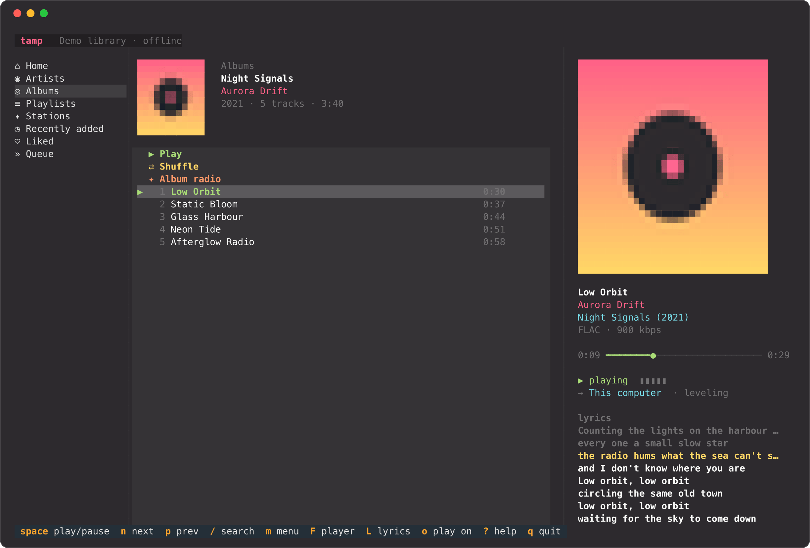
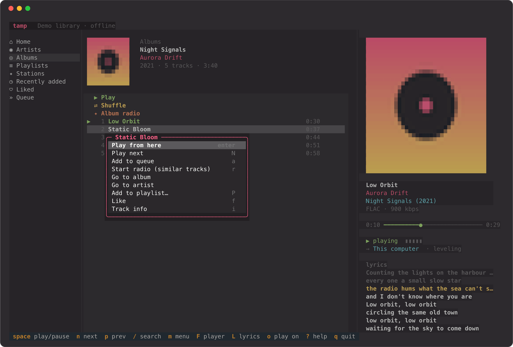
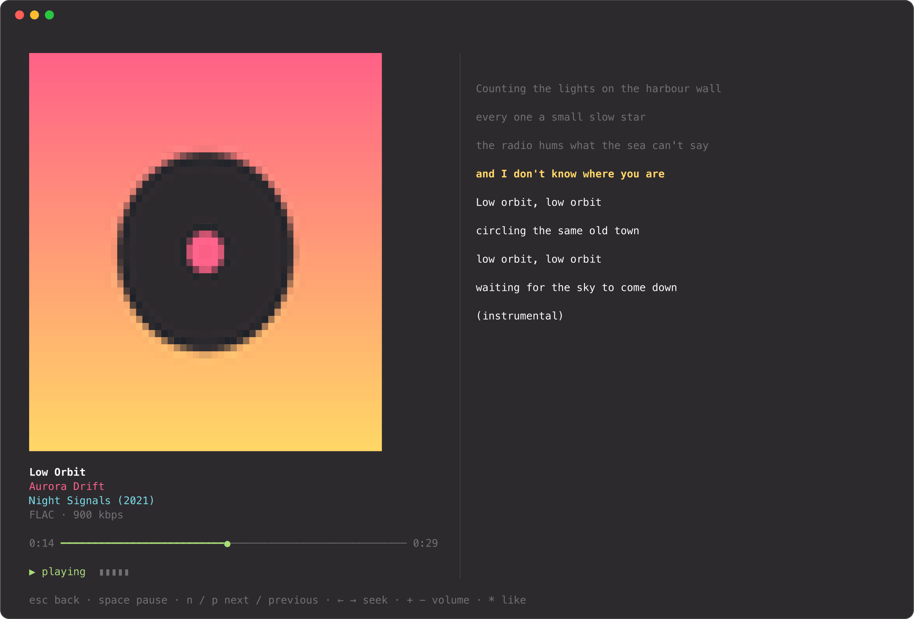
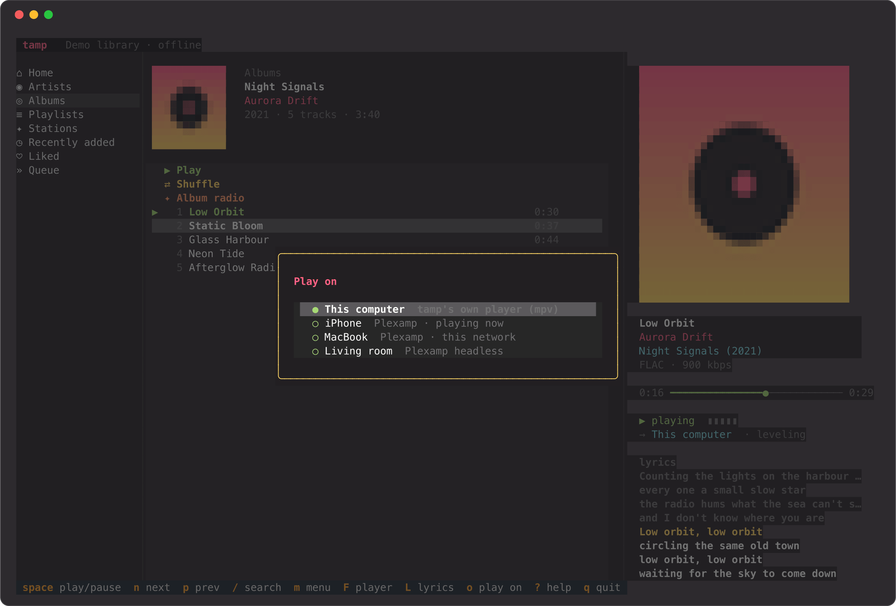
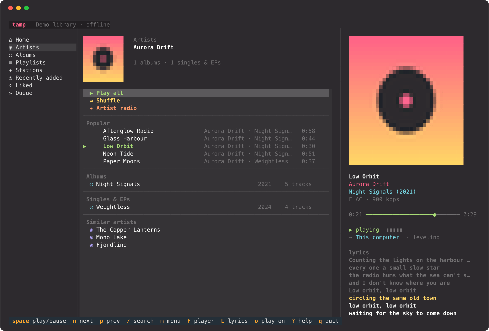
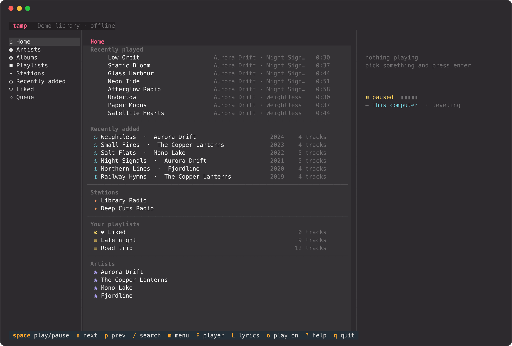
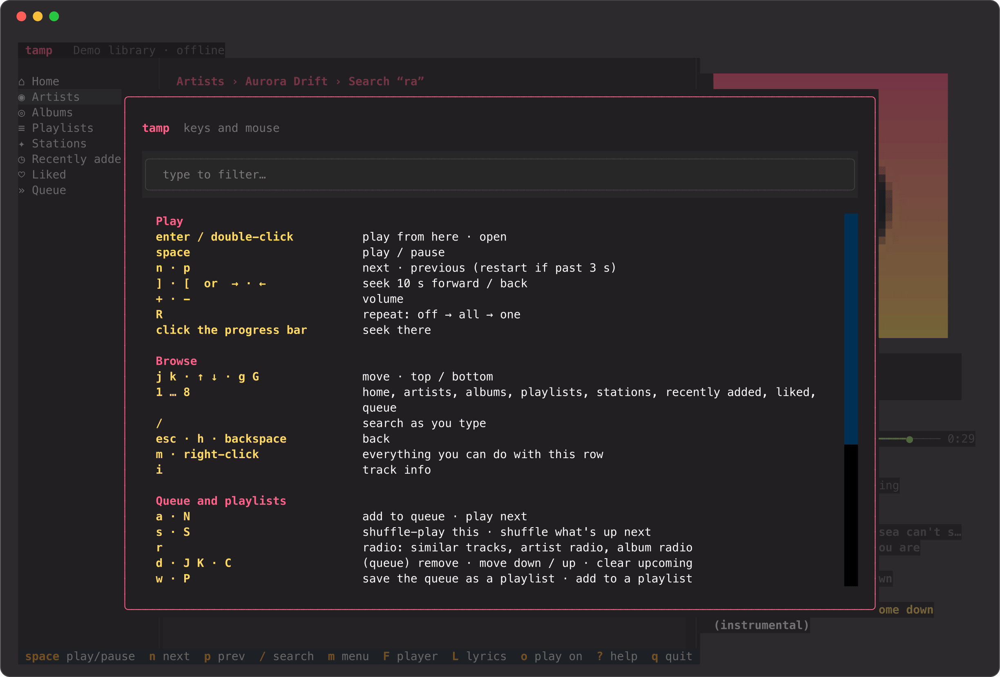

# tamp

**A Plexamp-style music player for the terminal.** Browse and search your Plex library, see synced lyrics, edit the queue and playlists. Play right in the terminal, or use tamp as the remote and lyrics screen for Plexamp running on your phone, your Mac or a headless box.

> [!WARNING]
> **This is vibe-coded.** It was written largely by an AI assistant (Claude) as a proof of concept, with a human steering, testing and reviewing it. It works for its author, but it hasn't had the scrutiny a hand-written project gets. Expect rough edges, read the code before trusting it with anything important, and file issues freely. tamp is not affiliated with or endorsed by Plex.



## Features

**Library**
- A home page built from your server's hubs (recently played, recently added, stations, playlists), like Plexamp's.
- Artists, albums, playlists, stations and liked tracks.
- Artist pages with popular tracks, albums, singles & EPs and sonically similar artists.
- Search as you type (`/`).

**Playing**
- Gapless playback through [mpv](https://mpv.io), with loudness leveling from Plex's own sonic analysis.
- Synced lyrics beside the music, full size (`L`), or in a full-screen player with big art (`F`).
- Radio from anything (`r`): sonically similar tracks, artist radio, album radio, plus your server's stations.
- Plays are reported to Plex, so history, play counts and "recently played" stay right everywhere.

**Queue and playlists**
- Play next, add to queue, shuffle, repeat, reorder, remove; the queue survives restarts.
- Save the queue as a playlist, or add anything to a playlist.
- Like tracks.

**Comfortable**
- Right-click (or `m`) on any row for everything you can do with it.
- Mouse support: click to select, double-click to play, click the progress bar to seek.
- A searchable help screen (`?`), track info with format and loudness (`i`), and a sleep timer (`z`).
- Vim keys throughout, and a sign-in flow that never asks you to paste a token.

**Remote control** (`o`, "Play on")
- Control Plexamp on another device, or just follow along with what it's playing.
- See [Remote control](#remote-control) for what works where.

**Shell**
- `tamp status` for your tmux bar, and `tamp toggle`, `next` and `prev` for key bindings.

<table>
  <tr>
    <td width="50%"><br>Right-click or <code>m</code>: every action for that row</td>
    <td width="50%"><br><code>F</code>: full-screen player, big art and synced lyrics</td>
  </tr>
  <tr>
    <td><br><code>o</code>: play here, or control Plexamp elsewhere</td>
    <td><br>Artist pages: popular, albums, singles & EPs, similar</td>
  </tr>
  <tr>
    <td><br>Home, from your library's hubs</td>
    <td><br><code>?</code>: every key, searchable</td>
  </tr>
</table>

Screenshots use `tamp --demo`, an invented offline library.

## Install

You need Python 3.11+, [uv](https://docs.astral.sh/uv/) and mpv:
- macOS: `brew install mpv`
- Debian / Ubuntu: `apt install mpv`
- Fedora: `dnf install mpv`
- Arch: `pacman -S mpv`

```sh
uv tool install git+https://github.com/samayc16/tamp
tamp            # sign in, then play
tamp --demo     # no Plex needed
```

**Signing in:** press `o` to open the Plex sign-in page or `c` to copy the link, scan the QR code with your phone, or enter the four-letter code at plex.tv/link. Then pick a Plex Home user (with their PIN if they have one), a server and a music library. `tamp logout` forgets it all.

## Remote control

Press `o` to choose where music plays. tamp finds players three ways: Plexamp on this computer, players registered on your Plex account, and players answering Plex's discovery broadcast on your network. It talks to them with the same remote-control protocol (Plex Companion) that Plexamp uses between its own devices.

| player | control from tamp | needs |
|---|---|---|
| **Plexamp on a Mac / PC** | full | same network, and *Remote Control* turned on in Plexamp's settings |
| **Plexamp headless / Caldera** | full | same network |
| **Plexamp on Android** | full while the app is running | same network |
| **Plexamp on an iPhone** | full while Plexamp is alive (it is while it's playing) | same Wi-Fi, and Plexamp allowed *Local Network* access in iOS Settings |
| **any of these, away from home** | follow: now playing, art and synced lyrics | nothing |

**Follow mode:** when a player can't be reached, tamp still shows what it's playing. Every Plex player reports its playback to your server, so tamp reads that session and keeps synced lyrics in time. This covers your phone on cellular, or Plexamp asleep in the background.

**Away from home:** Plexamp's own remote control works through a private Plex cloud relay that other apps can't use, so tamp only follows there.

## Use it from tmux

```tmux
set -g status-right '#(tamp status --tmux --width 40)%H:%M'
bind-key M-p run-shell 'tamp toggle'
bind-key M-n run-shell 'tamp next'
```

## How it works

| module | job |
|---|---|
| `plex.py` | plex.tv sign-in (two PINs: browser link and plex.tv/link code), Home users, servers, player discovery |
| `library.py` | browsing, hubs, search, radio, lyrics, art, ratings and play reports, via [python-plexapi](https://github.com/pushingkarmaorg/python-plexapi); `demo.py` is an offline stand-in |
| `mpv.py`, `output.py` | local playback through one mpv over JSON IPC, whose playlist holds the current track and the next (gapless); remote players through `companion.py`, with the server's sessions as fallback |
| `player.py`, `queue.py` | the queue as an immutable value, transport, play reporting, the status file for tmux |
| `ui/` | the [Textual](https://textual.textualize.io) app: browser, context menus, now playing, full-screen player, help |

**Your Plex token:**
- It's stored in `~/.config/tamp/config.json`, readable only by you.
- It's sent as a header, never in a URL or on a command line.
- It only goes to players at addresses plex.tv lists for your own devices, or to a player that first identified itself without it.

**Testing:**
- Unit tests cover the queue, lyrics, playback (with a real mpv, including the gapless hand-offs) and the remote-control protocol (against a stub player).
- Real-world testing against many Plex setups is still thin, so reports are welcome.

This Python version is the proof of concept. The plan is a Rust rewrite (ratatui + mpv) once the features have settled.

## Development

```sh
uv venv && uv pip install -e '.[test]'
.venv/bin/pytest
```

MIT licensed.
